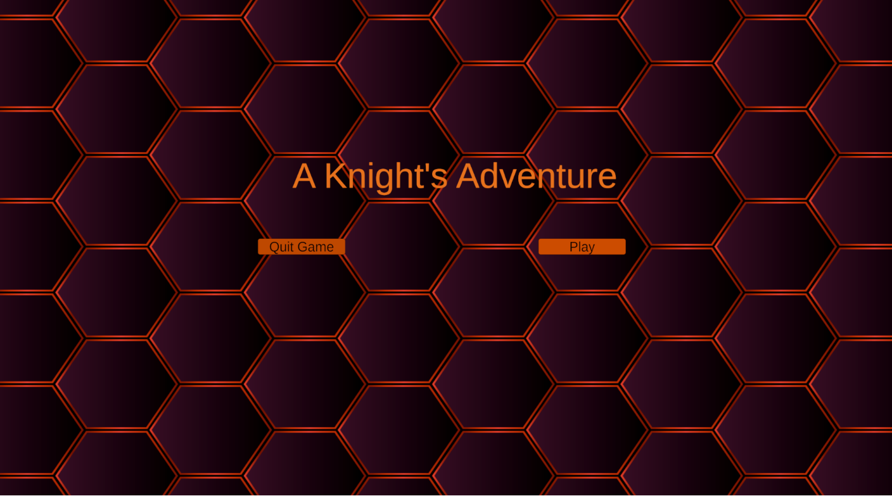
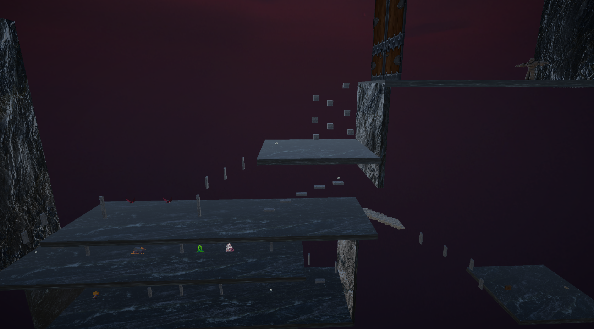
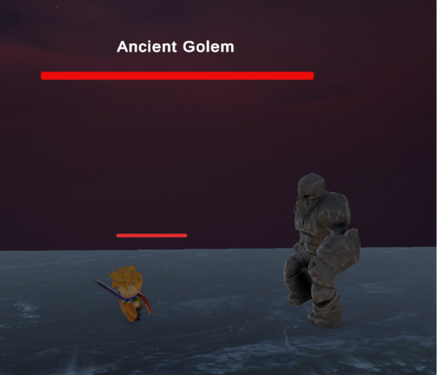

# Survival Platformer

A complete, playable 2D/3D-style survival platformer built in **Unity 6** with **C#**. It was my bachelor's thesis project at "Dunărea de Jos" University of Galați (Computer Science, Faculty of Automation, Computers, Electrical and Electronic Engineering, 2026). The game takes the player from a main menu, through a safe hub area, to a combat level that ends with a boss fight.

## Gameplay

- **Main menu:** start the game or quit.
- **Hub (`MainHub`):** a safe area where the player can move around and get used to the controls and the camera switch.
- **Level (`CaveLevel`):** platforming over an abyss, ground and flying enemies, collectible coins, and a final boss. Pushing a chest onto a pressure plate opens the gate to the boss arena.
- **End states:** a victory screen when the boss is defeated, a defeat screen when the player dies or falls into the abyss. A pause menu is available during play.

## Controls

| Action | Input |
|---|---|
| Move | `A` / `D` or arrow keys (`W` / `S` also move in the hub) |
| Jump / double jump | `Space` |
| Dash | `Left Shift` |
| Wall jump | Jump while touching a wall |
| Attack (sword) | `X` |
| Switch third person / first person camera | `C` |
| Look around (first person) | Mouse |
| Pause | `Esc` |

## Features

- **Character controller:** physics-based movement with double jump, dash and wall jump.
- **Camera system:** switches between third person and first person with a key press, with handling for the camera hitting the ceiling.
- **Health system:** event-based, so the UI updates automatically when health changes. It covers the player, the enemies and the boss, with health bars for the player and the boss.
- **Enemy AI:** different behaviours for ground enemies, flying enemies and the boss (patrol, chase, attack, detection radius, attack cooldown).
- **Combat:** sword attack with a short active window, damage to enemies and the boss, and damage to the player on contact.
- **Game management:** scene transitions, score and coin collection, pause menu, victory and defeat screens, audio and menus.
- **Edge cases handled:** victory and defeat screens can't trigger at the same time (for example falling into the abyss while killing the boss), and the chest resets to its start position after falling into the abyss.

## Technical notes

- **Engine:** Unity `6000.4.5f1` (Unity 6)
- **Language:** C#
- **Patterns used:** singleton managers (game manager, camera switcher), events for health and UI communication, coroutines for timed behaviour (for example boss attacks), and references wired through the Inspector.
- **Scenes:** `MainMenu` → `MainHub` → `CaveLevel`

## Getting started

1. Install Unity Hub and the editor version **6000.4.5f1**.
2. Clone this repository.
3. In Unity Hub choose **Add → Add project from disk** and select the cloned folder.
4. Open the project and the `MainMenu` scene, then press Play.

## Assets and credits

All third-party art, models, animations and sounds come from the **Unity Asset Store**:

Asset Store assets are used under the Unity Asset Store EULA and their respective licences. All gameplay scripts in this repository were written by me for this project.

## Thesis

The full design and implementation write-up (in Romanian) covers the requirements, architecture, system design, implementation with code samples, and testing: *Aplicație de programare vizuală în Unity cu C# – „Survival Platformer"*, supervised by Ș.l. Dr. Ing. Cristina Anton.

## Limitations and future work

- No save system; the game has to be played from the start each time.
- A single level and a single boss.
- The enemy AI is basic (patrol, chase, attack).
- No settings menu (volume, mouse sensitivity).
- Ideas for later: more levels and enemies, better AI, more weapons and abilities.

## Author

Alexandru Daniel Dobre